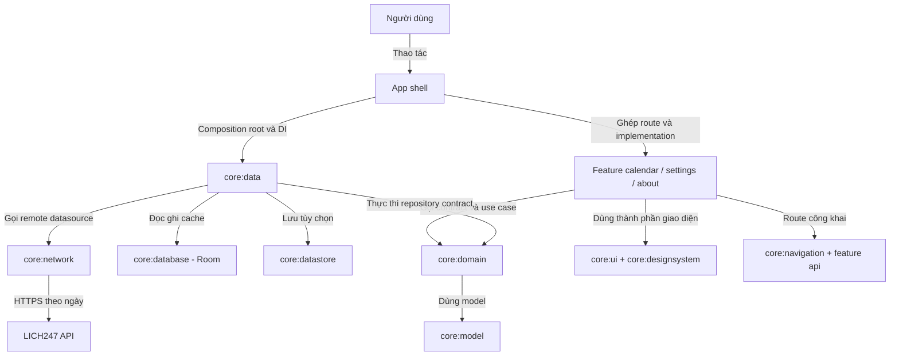

# Kiến trúc ứng dụng — đề xuất bước 5

Trạng thái: đã triển khai Android theo kiến trúc này trên develop; mô tả ban đầu được đối chiếu với code sau triển khai. Người dùng chấp nhận thiết kế và ủy quyền tự review/merge develop; main do người dùng kiểm thử và merge.

## Căn cứ đã khảo sát

Repo mẫu: `/home/dungpd2/Project/Android/nowinandroid`.

- `settings.gradle.kts`: composite build build-logic, core modules, feature api/impl.
- `build-logic/convention`: convention plugins cho app, library, Compose, feature api/impl, Hilt và Room.
- `docs/ArchitectureLearningJourney.md`: UI/domain/data, repository offline-first, Flow, ViewModel/UDF.
- `feature/foryou/api/build.gradle.kts` và `impl/build.gradle.kts`: contract điều hướng tách implementation, feature có thể dùng core/domain.
- `core/domain/build.gradle.kts`: trong NIA, domain phụ thuộc core/data; repository interface nằm core/data. App lịch đề xuất đặt interface ở domain để đảo chiều phụ thuộc rõ hơn; đây là điều chỉnh có chủ đích, không phải sao chép nguyên mẫu.
- `core/navigation/src/main/kotlin/.../Navigator.kt`, `app/src/main/kotlin/.../ui/NiaApp.kt` và version catalog có Navigation 3. AGENTS.md của mẫu còn mô tả Navigation 2: lấy code thực tế làm căn cứ, không sao chép mô tả cũ.

Không sửa repo mẫu. Không sao chép analytics, Firebase, notifications, WorkManager đồng bộ nền hoặc các module ngoài phạm vi app lịch. Khi tái sử dụng mã nguồn mẫu phải giữ thông báo giấy phép tương ứng.

## Module và cấu trúc triển khai

```text
app/                         Application, MainActivity, Hilt, app state, ghép feature
build-logic/convention/       Quy ước build chung
gradle/libs.versions.toml     Version catalog
core/
  model/                     Model nghiệp vụ thuần Kotlin
  domain/                    Repository contracts, use case thực sự cần, calendar rules
  data/                      Repository implementation, mapping, cache/refresh policy
  network/                   Retrofit/OkHttp, DTO, API validation
  database/                  Room entity, DAO, migration
  datastore/                 Lưu chế độ giao diện
  designsystem/              Theme, typography, component, asset con giáp/tranh
  ui/                        UI nghiệp vụ dùng chung: ngày, can chi, giờ hoàng đạo
  navigation/                Route typed, back stack và điều hướng dùng chung
feature/
  calendar/api/              Route lịch và chi tiết (LocalDate qua ISO string)
  calendar/impl/             S01, S11, D01, ViewModel, adaptive list/detail
  settings/api/              Contract mở cài đặt
  settings/impl/             S02, D02, state và effects
  about/api/                 Contract thông tin app
  about/impl/                S12, liên kết và thông tin nguồn
```

Clock được inject từ DataModule; chưa cần core:common riêng. Fixture demo nằm core:data/src/demo, không tạo core:testing khi chưa có unit tests theo chỉ dẫn. Trạng thái kết nối công khai dưới Flow trong CalendarRepository; AndroidNetworkMonitor ở data.

Calendar giữ cả lịch tháng và chi tiết: cùng dữ liệu và lựa chọn; trên màn rộng S11 là vùng trong S01. Không tạo module riêng cho từng dialog/toast. Chỉ khởi tạo module khi commit tương ứng có trách nhiệm cụ thể; không tạo hàng loạt module rỗng.

## Quan hệ thành phần

Mũi tên dưới đây là phụ thuộc compile-time hoặc tích hợp được ghi nhãn. Binding Hilt nối contract domain với implementation data tại composition root.



Feature không truy cập Retrofit/DAO hoặc feature impl khác. Network/database không phụ thuộc UI. Domain/model không phụ thuộc Android, Compose, Room, Retrofit hoặc DTO.

## Luồng dữ liệu và trạng thái

1. MainActivity ghép theme và app shell; calendar ViewModel giữ tháng xem/ngày chọn trong SavedStateHandle.
2. UI stateless nhận UiState và callback. ViewModel dùng StateFlow, collect theo lifecycle.
3. Repository phát Flow từ Room (nguồn dữ liệu ngày cho UI). Refresh là suspend action riêng; trạng thái refresh theo ngày không làm mất cache đã có.
4. API phải có solar khớp ngày yêu cầu và đủ trường cốt lõi; response hợp lệ mới được map và ghi Room trong transaction. Thiếu trường phụ giữ trạng thái unknown, không ép false.
5. Room phát dữ liệu mới; ViewModel cập nhật state. Request ngày cũ có thể được cache đúng khóa nhưng không được ghi đè vùng chọn mới. Observe theo lựa chọn hiện tại; gộp request trùng và giới hạn tải đồng thời ban đầu 2.
6. UiState tách data/loading/error/freshness. Lỗi có cache giữ dữ liệu + banner; lỗi không cache hiện retry. Dialog là state của màn, dùng giá trị tạm khi sửa. Toast điều khiển bằng effect có ID/ack sau xử lý; không bắn lại từ trạng thái success mỗi lần recomposition.
7. Chuyển một/hai vùng theo kích thước cửa sổ, giữ selection/back stack; Back đóng dialog trước rồi về màn cha theo UX.

## Quy tắc lịch, ảnh và tích hợp

- LocalDate cho ngày, YearMonth cho lịch tháng; Clock inject được, Hôm nay theo Asia/Ho_Chi_Minh. Không đổi ngày thành UTC timestamp để gọi API.
- Domain giữ quy tắc dựng lưới tháng, xác thực ngày và chọn chủ đề ảnh; không tự tính âm lịch thay API ngoài spec.
- AssetResolver phía UI map Zodiac/DayTheme sang resource; domain không chứa drawable ID. Cờ mâu thuẫn/thiếu dùng ảnh trung tính; Đại cát hiển thị riêng. Tranh có rắn chỉ dành ngày Tỵ, không áp cho mọi con giáp.
- Ưu tiên asset local, tối ưu dung lượng khi đóng gói. Không sinh ảnh lúc mở app. Giữ nguồn artwork gốc tại design/ui-v2.
- Demo dùng fixture đã kiểm chứng, không tự giả lập âm lịch cho mọi ngày. Prod dùng API; UI không biết đang dùng nguồn nào.
- Không hứa full offline hoặc quota chưa xác minh; việc xác nhận quyền dùng API trước production theo API_VALIDATION.md vẫn còn hiệu lực.

## Công nghệ và quyết định cần khóa khi khởi tạo

Đề xuất Compose Material 3 + adaptive, Hilt, Coroutines/Flow, Room, Preferences DataStore, Retrofit/OkHttp + Kotlin serialization, type-safe navigation theo cấu trúc mẫu. Ưu tiên phiên bản stable tương thích; không tự sao chép dependency alpha có trong mẫu. Kiểm tra dependency/API chính thức và môi trường SDK/JDK ở commit bootstrap trước khi khóa version.

Đã dùng minSdk26, compile/target API37.0, AGP9.3.2, Gradle9.7.1, Kotlin2.3.0 và JDK25 trên máy. ApplicationId, tên app và dải năm chính thức cần khóa trước release; namespace tạm có thể dùng `com.lichvannien` cho giai đoạn phát triển. Đây chưa phải applicationId đã được người dùng xác nhận.

## Kiểm chứng

Mỗi commit chạy build/lint/test liên quan, giữ demo build được. Theo chỉ dẫn hiện tại không viết unit test mới. Nếu bổ sung sau này, ưu tiên calendar grid, múi giờ, mapper sai ngày, cache/retry/concurrency và ViewModel. Kiểm chứng hiện tại tập trung build/lint và hành vi trên emulator, có screenshot hẹp/rộng/sáng/tối.

Chi tiết thứ tự công việc tại [COMMIT_PLAN.md](project/COMMIT_PLAN.md).


## Bằng chứng hiện tại

Build demo/prod và Android lint đã pass. Runtime và giới hạn tại [QA_REPORT.md](project/QA_REPORT.md). Không có unit test mới theo yêu cầu người dùng. CI mới có script/template, chưa chạy trên GitHub.
